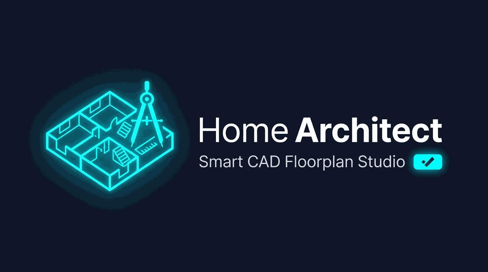

<p align="center">
  
</p>

<p align="center">
  <strong>Le studio de CAO et de plans d'étage interactifs pour Home Assistant & Lovelace</strong><br/>
  <em>Concevez, meublez, cotez et animez vos plans en 2D/3D directement dans votre navigateur.</em>
</p>

<p align="center">
  
  
  
  
  <a href="https://buymeacoffee.com/Socrate"></a>
</p>

---

## 📦 Installation & Configuration

### 1. Installation via HACS

1. Ouvrez **HACS** dans votre barre latérale Home Assistant.
2. Cliquez sur le menu avec les trois petits points (en haut à droite) ➔ **Dépôts personnalisés** (*Custom repositories*).
3. Ajoutez l'URL du dépôt :
   `https://github.com/SocrateMobile/home-architect`
   avec le type **Intégration** (*Integration*).
4. Cliquez sur **Intégrations** puis recherchez **Home Architect**.
5. Cliquez sur **Télécharger** en bas à droite pour installer la dernière version.
6. **Redémarrez Home Assistant** pour que la nouvelle intégration soit prise en compte.

### 2. Ajout de l'intégration

Une fois Home Assistant redémarré :
1. Rendez-vous dans **Paramètres** > **Appareils et services**.
2. Cliquez sur **Ajouter une intégration** en bas à droite.
3. Recherchez **Home Architect** et sélectionnez-la.
4. Validez l'assistant de configuration.
5. Une entrée **Home Architect** apparaît désormais dans la barre latérale gauche de votre interface (`/home-architect`).

---

## 🖥️ Utilisation du Studio

Cliquez sur **Home Architect** dans la barre latérale pour ouvrir le studio de CAO :

* **Nouveau plan (`📄 Nouveau plan...` ou `Ctrl+N`)** : Créez un étage ou une zone (Sous-Sol, RDC, 1er Étage, Jardin, etc.).
* **Import d'un plan existant** : Importez une image (PNG, JPG, SVG, WebP) ou collez-la depuis le presse-papier (`Ctrl+V`), ajustez l'échelle métrique avec l'outil règle (📏) et dessinez par-dessus en filigrane.
* **Mise à l'échelle automatique (Touche `S`)** : Indiquez la mesure réelle d'un mur pour recalculer proportionnellement l'ensemble du plan et des surfaces.
* **Dessin des murs & cloisons** : Tracez facilement avec accroche magnétique (snapping) angulaire ($0^\circ, 45^\circ, 90^\circ$) et épaisseur au choix (10 cm, 15 cm, 20 cm, 30 cm).
* **Entités Home Assistant en direct** : Glissez-déposez vos lumières, interrupteurs, thermostats, caméras et capteurs depuis le volet latéral droit.
* **Visite 3D & Walkthrough (🚶)** : Basculez en mode 3D temps réel avec textures procédurales, calcul d'ensoleillement synchronisé avec `sun.sun` et visite à la première personne (touches ZQSD / Flèches).

---

## 🎴 Carte Lovelace pour Tableau de bord (Dashboard Card)

Home Architect fournit une carte Lovelace dédiée pour afficher vos plans interactifs directement sur vos tableaux de bord.

### Ajout via l'interface graphique
1. Modifiez votre tableau de bord Lovelace (*Modifier le tableau de bord*).
2. Cliquez sur **Ajouter une carte** et choisissez **Home Architect Card** (ou ajoutez une carte Manuel).
3. Sélectionnez votre plan dans la liste déroulante et ajustez les options visuelles.

### Configuration YAML

```yaml
type: custom:home-architect-card
project_id: rdc
title: Rez-de-chaussée
height: 500px
view_mode: 2d
show_header: true
show_controls: true
show_dimensions: false
show_heatmap: false
animations: true
theme: auto
```

### Options de la carte

| Option | Type | Défaut | Description |
| :--- | :--- | :--- | :--- |
| `project_id` | `string` | *Optionnel* | Identifiant du plan à afficher (ex: `rdc`, `etage1`). S'il n'est pas spécifié, le premier plan disponible est chargé. |
| `title` | `string` | *Optionnel* | Titre affiché dans l'en-tête de la carte. |
| `height` | `string` / `number` | `480px` | Hauteur de la carte sur le tableau de bord (ex: `500px` ou `500`). |
| `view_mode` | `string` | `2d` | Mode de visualisation initial : `2d` (plan vectoriel) ou `3d` (vue tridimensionnelle interactive). |
| `show_header` | `boolean` | `true` | Affiche ou masque l'en-tête avec le titre de la carte. |
| `show_controls` | `boolean` | `true` | Affiche les boutons de contrôle interactifs sur le plan (zoom, recentrage, bascule 2D/3D). |
| `show_dimensions` | `boolean` | `false` | Affiche les cotes métriques numériques des murs sur la carte. |
| `show_heatmap` | `boolean` | `false` | Active la visualisation thermique de la température des pièces. |
| `animations` | `boolean` | `true` | Active les animations en direct des entités (icônes de ventilateurs en rotation, flux). Peut être désactivé sur tablettes murales peu puissantes pour économiser les ressources. |
| `theme` | `string` | `auto` | Thème visuel du canevas : `auto` (suit le mode sombre/clair de Home Assistant), `light` ou `dark`. |

---

## 🌐 Publication d'un Plan & Accès Public

Home Architect vous permet d'exporter et de publier votre plan d'étage sous forme de fichier vectoriel SVG autonome pour l'intégrer facilement dans des cartes *Picture Elements*, des écrans déportés ou des pages web externes.

### Comment publier un plan ?
1. Ouvrez le projet dans le studio Home Architect.
2. Cliquez sur le bouton **Exporter / Publier** dans la barre d'outils.
3. Choisissez si vous souhaitez inclure l'image de fond ou uniquement le tracé vectoriel, puis cliquez sur **Publier**.
4. L'outil génère une URL sécurisée avec un jeton cryptographique unique :
   ```text
   /api/home_architect/published/<identifiant_projet>-<jeton_secret>.svg
   ```

### ⚠️ Avertissement de sécurité & Confidentialité
> [!IMPORTANT]
> **Accès sans authentification** : Un plan publié est accessible publiquement via son URL par **toute personne disposant du lien**, sans nécessiter de connexion ni de compte Home Assistant (`requires_auth = False`). Cela permet son utilisation directe dans des cartes locales ou des afficheurs connectés.
>
> **Protection cryptographique** :
> * L'URL intègre un jeton aléatoire de haute entropie généré de façon sécurisée (imprévisible et non devinable).
> * Les requêtes sont protégées contre les attaques temporelles (*timing attacks*) via une validation en temps constant (`hmac.compare_digest`).
> * Le SVG est assaini à la publication et servi avec des en-têtes de sécurité stricts (Content Security Policy restrictive `sandbox`, `X-Content-Type-Options: nosniff`).
> * Aucun fichier n'est écrit dans le dossier public `/config/www`.

### Comment dépublier un plan ?
Pour révoquer immédiatement l'accès à un plan publié :
1. Ouvrez le plan dans le studio Home Architect.
2. Cliquez sur l'outil **Exporter / Publier**.
3. Cliquez sur le bouton **Dépublier (Unpublish)**.
4. Le fichier publié et son jeton d'accès sont immédiatement détruits sur le serveur. Toute requête ultérieure sur l'ancienne URL retournera une erreur `404 Not Found`. Si vous republiez le plan ultérieurement, un nouveau jeton aléatoire sera généré.

---

## 🌟 Fonctionnalités Détaillées

* **Moteur 3D temps réel nouvelle génération (WebGL / Three.js)** :
  * **Textures architecturales procédurales** : Parquet chêne, grands carreaux 60×60, mosaïque, béton ciré, terrasse bois, pelouse et moquette — générées mathématiquement en canevas avec projection métrique UV sans alourdir le bundle.
  * **Visite virtuelle à la première personne (Walkthrough 🚶)** : Hauteur des yeux humaine (1.65 m), pilotage fluide clavier (ZQSD / Flèches), course (`Shift`), orientation 360° souris/toucher et HUD d'aide.
  * **Simulation solaire dynamique connectée à `sun.sun`** : Course du soleil en direct d'après les coordonnées GPS de Home Assistant (azimut, élévation, ombres douces PCF, Golden Hour, ambiance nocturne avec illumination douce des lampes).
  * **Empilement multi-niveaux 3D** : Visualisation tridimensionnelle des dalles de sol, trémies et niveaux inférieurs en filigrane sous le plan actif.
  * **Coupe à mi-hauteur des murs (✂️)** : Visualisation instantanée de l'intérieur des pièces et du mobilier.
* **Accroche magnétique intelligente (Snapping)** :
  * Grille métrique adaptative ($0.50\,\text{m}, 1.0\,\text{m}$).
  * Contraintes angulaires automatiques ($0^\circ, 45^\circ, 90^\circ, 135^\circ, 180^\circ$).
  * Accrochage automatique sur les sommets (vertices) des murs voisins.
* **Persistance native Home Assistant** :
  * Stockage atomique dans `.storage/home_architect.projects` via l'API WebSocket Home Assistant.
  * Gestion multi-niveaux (Sous-Sol, RDC, 1er Étage, Jardin).

---

## 🏗️ Structure du Projet

```text
domolink-plan/
├── custom_components/
│   └── home_architect/
│       ├── __init__.py           # Enregistrement du composant et du panel
│       ├── assets.py             # Gestion sécurisée des assets et plans publiés
│       ├── const.py              # Constantes
│       ├── config_flow.py        # Assistant d'installation Home Assistant
│       ├── http.py               # Vues HTTP sécurisées pour fonds et plans
│       ├── storage.py            # Persistance atomique .storage
│       ├── websocket.py          # Commandes WebSocket
│       ├── manifest.json         # Manifest HACS / HA
│       └── frontend/
│           └── home_architect-panel.js  # Bundle Lit / TypeScript compilé
├── src/
│   ├── components/               # Composants UI, éditeur de carte et modales
│   ├── core/                     # Moteur géométrique, snapping, modèles
│   ├── styles/                   # Styles modernes Glassmorphism & thèmes
│   ├── view3d/                   # Scène WebGL / Three.js et visite 3D
│   ├── home-architect-panel.ts   # Composant panneau principal
│   └── home-architect-card.ts    # Carte Lovelace pour tableau de bord
├── package.json
├── tsconfig.json
└── vite.config.ts
```

---

## 🚀 Compilation & Développement

Pour développer et recompiler le frontend :

```bash
# Installation des dépendances
npm install

# Build de production vers custom_components/home_architect/frontend/
npm run build
```

---

## ☕ Soutenir le projet / Support

Si vous appréciez cette intégration et souhaitez soutenir son développement continu ainsi que la maintenance des futures versions :

<a href="https://buymeacoffee.com/Socrate" target="_blank">
  
</a>
